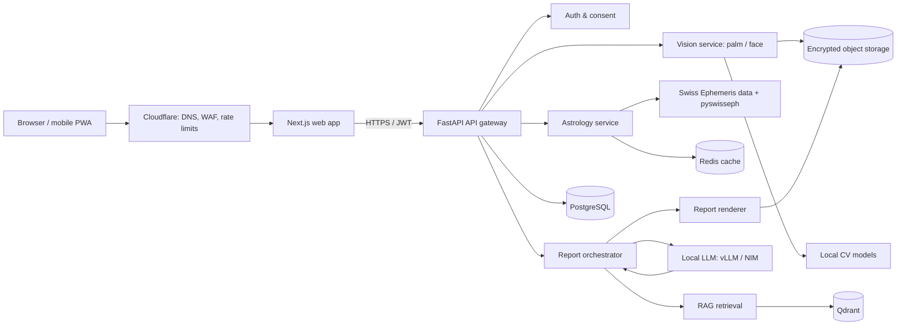
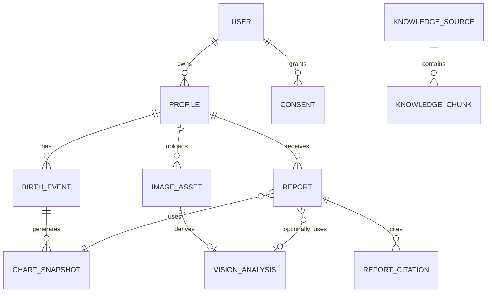
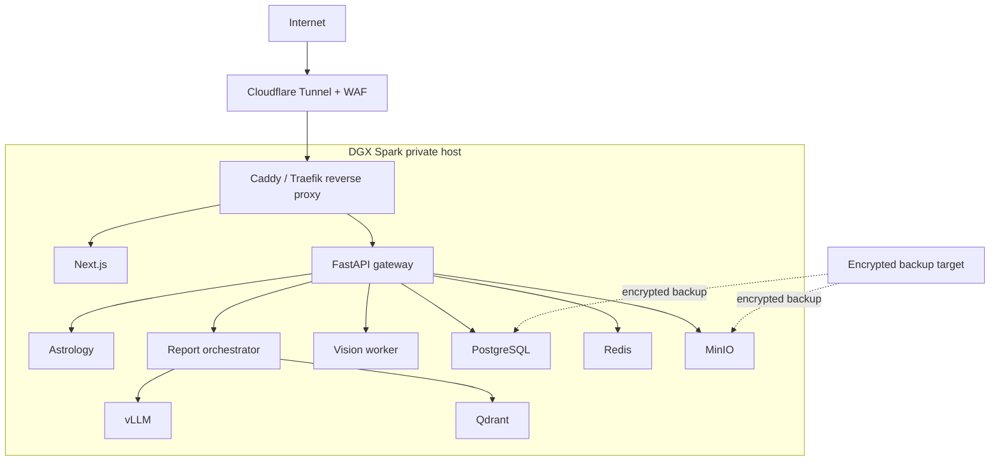

# Advance Astro — Privacy-First AI Astrology Platform Architecture

> **Product stance:** Natal-chart calculations are deterministic astronomy/math. Palm and face modules are optional spiritual/entertainment interpretations, not medical, identity, personality, financial, legal, or guaranteed-future assessments. Do not label outputs as scientifically “verified”. Use **Dual Insight**: `kundli rule result + optional visual-symbolic reading`.

## 1. Goals and non-negotiables

- All birth-chart math is calculated from code and validated against reference charts; an LLM never calculates degrees, houses, dashas, or lagna.
- Photos and personal data stay on the user's own DGX Spark deployment by default. No image, prompt, or chart is sent to a third-party LLM.
- A user can see, export, and permanently delete every profile, chart, image, conversation, and report.
- Palm/face analysis is explicit opt-in, is isolated from account identity, and raw images are deleted after the chosen retention period (default: immediately after feature extraction).
- The application does not perform face recognition, age/gender/race/emotion inference, liveness/surveillance, or medical diagnosis.

## 2. System map



**Deployment boundary:** Place every box after Cloudflare on the DGX Spark/private LAN. Cloudflare Tunnel only exposes a reverse-proxy route to the web/API service; PostgreSQL, Redis, Qdrant, model endpoints, and object storage must have no public port.

## 3. Services

| Service | Recommended implementation | Owns |
|---|---|---|
| Web | Next.js, TypeScript, Tailwind, shadcn/ui | Login, consent UI, chart/report dashboard, upload UI |
| API gateway | FastAPI, Pydantic, SQLAlchemy/Alembic | Versioned REST API, authorization, validation, rate limits |
| Auth | Keycloak (self-hosted) or Auth.js + local credentials | Users, MFA/passkeys, sessions, roles |
| Astrology engine | Python, `pyswisseph`, custom Vedic rules | Time-zone conversion, planetary positions, ayanamsa, houses, nakshatra, Vimshottari dasha, divisional charts |
| Vision engine | Python, FastAPI worker, PyTorch/ONNX Runtime/TensorRT | Image quality checks, palm segmentation, landmark/line feature extraction; optional face-image quality/landmark analysis |
| Interpretation engine | FastAPI orchestrator + vLLM or NVIDIA NIM | Rule-grounded prompts, citation assembly, safety checks, structured report JSON |
| Knowledge base | Qdrant + local embeddings model | Licensed/public-domain source chunks, rules, citations and versioning |
| Data layer | PostgreSQL + Redis + MinIO/S3-compatible storage | Transactional data, cache/jobs, encrypted files/reports |
| Background jobs | Celery/Dramatiq + Redis or RabbitMQ | Image processing, report generation, PDFs, deletion jobs |
| Observability | OpenTelemetry, Prometheus, Grafana, Loki | Metrics, traces, redacted application logs |

## 4. Core data flow

### A. Kundli generation

1. Client submits birth date, exact local time, place, time-zone, and selected ayanamsa.
2. API validates IANA time zone and geocodes only through a self-hosted/local gazetteer where possible; user confirms coordinates.
3. Astrology service converts local time to UTC/JD and uses pinned Swiss Ephemeris data/version.
4. It returns a versioned `ChartSnapshot` containing positions, houses, nakshatras, dashas, assumptions, and calculation provenance.
5. The snapshot is hashed and stored; Redis caches it by normalized inputs + engine version.

### B. Palm / face upload and optional Dual Insight

1. Client shows separate consent and capture guidance; user chooses an expiry (`delete after analysis` default).
2. Browser strips EXIF location data before upload and sends an encrypted HTTPS upload using a short-lived signed URL.
3. A background worker virus-scans, validates MIME/magic bytes, applies size limits, then encrypts the object with a per-object data key.
4. Vision service performs quality checks. If adequate, it extracts non-identifying symbolic features into `VisionAnalysis`; it does not create an identity embedding.
5. The orchestrator takes only `ChartSnapshot`, selected `VisionAnalysis`, user question, and retrieved sources.
6. Rules engine builds evidence blocks. Local LLM turns them into a cautious, cited, structured report. A validator blocks unsupported certainty/medical/financial claims.
7. User sees sources, chart facts, caveats, and distinct sections: `Kundli observations`, `Palm/face observations`, `Where they align`, `Where they differ`.
8. Worker deletes the raw image at expiry and cryptographically erases its object key. Derived analysis is separately controllable by the user.

## 5. Domain model



Essential tables:

- `users(id, email_hash, auth_subject, created_at, deleted_at)`
- `profiles(id, user_id, display_name_ciphertext, relationship, created_at)`
- `birth_events(id, profile_id, local_datetime_ciphertext, timezone, latitude, longitude, precision, consent_version)`
- `chart_snapshots(id, birth_event_id, engine_version, ephemeris_version, input_hash, payload_jsonb, created_at)`
- `consents(id, user_id, purpose, version, granted_at, revoked_at, retention_days)`
- `image_assets(id, profile_id, purpose, object_key, key_ref, sha256, expires_at, status)`
- `vision_analyses(id, image_asset_id, model_version, features_jsonb, quality_jsonb, created_at)`
- `reports(id, profile_id, chart_snapshot_id, vision_analysis_id?, prompt_version, model_version, output_jsonb, status)`
- `knowledge_sources(id, title, licence, edition, source_uri, ingestion_version)` and `knowledge_chunks(...)`
- `audit_events(id, actor_id, action, target_type, target_id, metadata_redacted, created_at)`

Keep birth inputs and image references encrypted. Do not put photos, birth timestamps, prompts, access tokens, or report content in logs.

## 6. API surface (v1)

| Method | Endpoint | Purpose |
|---|---|---|
| `POST` | `/v1/profiles` | Create a private/person/family profile |
| `POST` | `/v1/profiles/{id}/birth-events` | Save birth details with consent |
| `POST` | `/v1/charts` | Calculate or retrieve a chart snapshot |
| `GET` | `/v1/charts/{id}` | Get facts/provenance and chart visualization payload |
| `POST` | `/v1/uploads/intents` | Obtain a short-lived, purpose-scoped upload URL |
| `POST` | `/v1/images/{id}/analyse` | Queue palm/face feature analysis |
| `POST` | `/v1/reports` | Queue Kundli-only or Dual Insight report |
| `GET` | `/v1/reports/{id}` | Fetch report/status/PDF link |
| `DELETE` | `/v1/images/{id}` | Delete raw image and key immediately |
| `GET` | `/v1/privacy/export` | Export all user data |
| `DELETE` | `/v1/account` | Start verified account/data erasure |

Use JSON response envelopes with `request_id`, calculation/model versions, and human-readable warnings. Make report generation asynchronous: respond `202 Accepted` with a job/report id and stream progress over SSE.

## 7. Astrology engine design

```text
astrology-engine/
  api.py                  # Internal FastAPI interface
  domain/
    birth_input.py
    chart_snapshot.py
    provenance.py
  calculators/
    julian_day.py
    planets.py             # Swiss Ephemeris adapter
    houses.py
    ascendant.py
    nakshatra.py
    dasha_vimshottari.py
    divisional_varga.py
  rules/
    vedic/                 # Declarative, testable rule data
    western/
  validation/
    reference_cases.py
```

Rules must be declarative/configured and versioned. Every calculation record should include: location, IANA zone, UTC instant, ayanamsa, house system, ephemeris file/version, engine version, and any uncertainty in birth time. Build golden tests from manually verified reference charts and DST/historical-time-zone edge cases.

## 8. Vision design

Palm pipeline:

```text
upload -> safety/MIME scan -> quality gate -> hand/palm segmentation
       -> orientation + ROI normalization -> line/texture feature extractor
       -> confidence scoring -> symbolic feature JSON -> raw-image deletion policy
```

Face-image pipeline (only if retained):

```text
upload -> safety/MIME scan -> quality gate -> face presence / pose / lighting check
       -> optional non-identifying landmark geometry -> confidence JSON
       -> no face embedding, matching, demographics, emotion, health, or identity analysis
```

Use a human-readable capture guide: evenly lit image, uncluttered background, one open palm, no rings where possible, no other person. A low-confidence result must say it cannot provide an interpretation; never fabricate features. Models and training data require a legal license for commercial use.

## 9. RAG + local LLM design

1. Ingest only public-domain, owned, or explicitly licensed works. Store source, edition, licence, pages/sections, and translation metadata.
2. Chunk by semantic section; create local embeddings; store text, metadata, and vector in Qdrant.
3. Retrieve per report based on deterministic chart facts and question—not private raw images.
4. Use a strict system prompt: LLM may explain supplied facts and sources, may not invent calculations, citations, or certainty.
5. Have the LLM return validated JSON, e.g. `observations[]`, `cross_matches[]`, `caveats[]`, `citations[]`, `follow_up_questions[]`.
6. Validate JSON schema, citations, safety constraints, and numerical references before rendering HTML/PDF.

Hardware starting point for a DGX Spark:

- A 7B–14B instruct model is a sensible first production model; quantize according to quality/latency tests.
- Use vLLM for an OpenAI-compatible internal API; use a small local embedding model for RAG.
- Keep CV inference in a separate process/container with GPU resource limits so report traffic cannot exhaust the machine.
- Record model version, quantization, prompt version, and retrieved chunk IDs on every report.

## 10. Security and privacy controls

- TLS end-to-end; HSTS, CSP, CSRF protection, secure/httpOnly cookies, short-lived refresh sessions, MFA/passkeys for admins.
- Argon2id password hashing if passwords are offered; preferably self-hosted OIDC/passkeys.
- Row-level authorization: users may only access their own profiles, assets, charts, and reports; service roles use separate DB credentials.
- Envelope-encrypt sensitive database fields and object-store assets; store master keys in a local secrets manager/KMS, never source code or `.env` committed to Git.
- Private network only for internal services. Firewall allow-list, mTLS/service tokens between services, and no Docker daemon socket mounted into app containers.
- Upload restrictions: signed URLs, 10 MB limit, image MIME magic-byte validation, malware scanning, EXIF stripping, image decompression-bomb limits, image re-encoding.
- Abuse controls: CAPTCHA/rate limit at edge, per-user quotas, prompt-injection resistant RAG boundaries, moderation of user-provided text.
- Immutable, redacted audit trail for admin/data operations; quarterly restore test from encrypted backups.

## 11. Deployment topology



Run services in Docker Compose for development, then move to a single-node k3s deployment only when upgrades, health checks, and GPU scheduling make the complexity worthwhile. Separate `dev`, `staging`, and `production` secrets and storage buckets.

## 12. Suggested monorepo

```text
advance-astro/
  apps/
    web/                   # Next.js
    api/                   # FastAPI gateway
  services/
    astrology-engine/
    vision-engine/
    report-engine/
    ingestion/
  packages/
    contracts/             # OpenAPI-generated TS/Python client types
    chart-renderer/
    prompts/
    ui/
  infra/
    compose/
    k8s/
    caddy/
    monitoring/
  data/
    ephemeris/             # Not checked into Git if licensed/restricted
    knowledge-manifest/
  docs/
    ADRs/
    threat-model.md
  tests/
    golden-charts/
    integration/
    e2e/
```

## 13. Build order

### Phase 1 — trusted Kundli MVP

Implement authentication, profile/birth capture, deterministic Swiss Ephemeris calculations, chart visualisation, golden tests, and export/delete controls. No LLM, payments, or images yet.

### Phase 2 — private report generation

Add local vLLM, licensed knowledge corpus + Qdrant, structured/cited reports, queue workers, PDF rendering, observability, and red-team tests.

### Phase 3 — optional palm insight

Add consent screens, secure uploads, a palm quality/feature pipeline, retention/deletion jobs, clear confidence states, and the Dual Insight report sections.

### Phase 4 — face-photo feature (only after review)

Only add if privacy/legal review, consent language, a permitted model/data set, and strict non-identification boundaries are complete. This is the highest-sensitivity optional module.

### Phase 5 — commercial integrations

Add Razorpay/Stripe, webhook verification, invoice/refund flows, report entitlements, and—only where opt-in/approved—WhatsApp or voice delivery. Payments must not be hosted on the DGX app; use provider checkout/tokenization.

## 14. Acceptance criteria before launch

- Reference-chart test suite passes against agreed expected planetary positions and dashas.
- Same normalized input always returns the same chart snapshot/versioned output.
- No external network call occurs during a report except approved tunnel/payment/notification paths; prove via egress policy/logs.
- Raw uploaded photo is deleted at selected expiry and becomes irrecoverable from storage/key access.
- A user cannot retrieve another user's chart, image, report, PDF, or signed upload URL.
- All report claims point to a rule/source or are marked interpretive; prohibited claims are blocked.
- Backup restore, account export, and account erasure have been tested end-to-end.

## 15. Decisions to make before implementation

1. Vedic scope for v1: ayanamsa, house system, chart styles, languages (Hindi/English), and required dashas/vargas.
2. Whether birth data is stored permanently, encrypted, or calculated from an ephemeral session only.
3. The exact raw-photo retention policy (recommended default: delete immediately after feature extraction).
4. Jurisdictions and applicable privacy/legal review, especially before collecting biometric images or charging users.
5. Which source texts are legally licensed for commercial RAG use.

